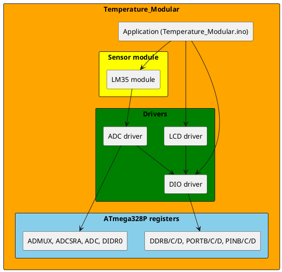
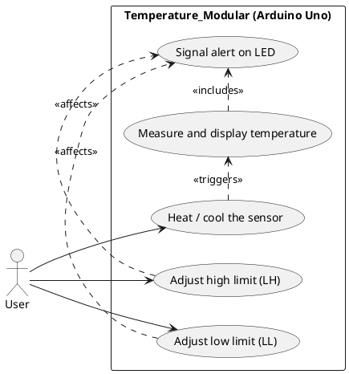
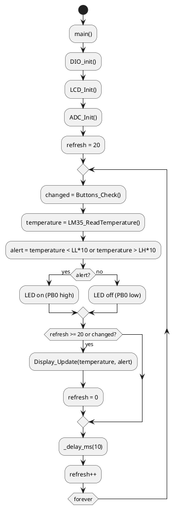
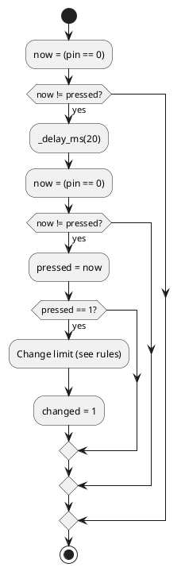
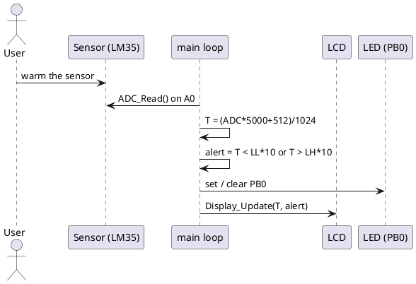
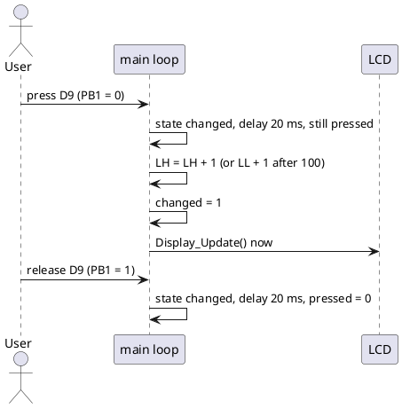
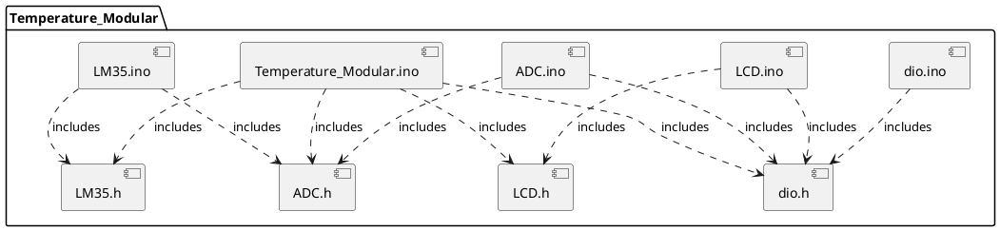

# Detailed Design Document

| **Author**              | `Rovena Rafik, Muhab Mahmoud`                         |
|:------------------------|:-----------------------------------------------------|
| **Status**              | `Final`                                              |
| **Version**             | `1.0`                                                |
| **Date**                | `19/11/2026`                                         |

## Introduction

This document describes the design of **Temperature_Modular**, a C firmware for an Arduino Uno (ATmega328P) that measures a temperature with an LM35 sensor, shows it on a 16x2 character LCD, and switches an alert LED when the temperature leaves a range (low limit **LL**, high limit **LH**) that the user adjusts with two push buttons.

### Purpose

The purpose of this document is to describe the requirements, architecture, software modules, display behaviour, known limitations and verification approach of Temperature_Modular, so that the implementation can be reviewed and tested.

### Scope

Requirements (derived from the implementation):

* Read the LM35 temperature sensor through the ADC and convert the reading to degrees Celsius.
* Show the temperature, the alert status and the two limits (LL, LH) on a 16x2 LCD.
* Let the user change the limits with two push buttons (one for LH, one for LL).
* Turn an alert LED on when the temperature is below LL or above LH.
* Native C programming (no Arduino API, no pre-developed driver libraries).

In scope: one LM35 sensor on A0, one 16x2 LCD in 4-bit mode, two push buttons, one alert LED. The code is split into independent modules (DIO, ADC, LCD, LM35) used by one application file.

Out of scope: sensor fault detection, alert hysteresis, negative temperatures, storing the limits in EEPROM, communication with a PC, calibration.

### Industrial Relevance

The project is a simplified model of three concepts used in automotive and industrial embedded systems: **data acquisition** (reading an analog sensor through an ADC and converting it to a physical value), **monitoring and alarming** (comparing a measured value with configurable limits and raising an alert) and **human-machine interface** (showing values on a display and changing parameters with buttons). In a car, an ECU may monitor coolant or battery temperature, warn the driver when it leaves its allowed range, and show it on the instrument cluster. This project does not implement a real vehicle system; it only demonstrates the same basic principles.

## Architectural Overview

The application (`Temperature_Modular.ino`) uses four modules: the `DIO` driver, the `ADC` driver, the `LCD` driver and the `LM35` conversion module. Each module has a header file (`.h`, public interface) and an implementation file (`.ino`). The modules access the ATmega328P registers directly.

### Hardware

| Item | Arduino pin | MCU pin | Connection |
|------|-------------|---------|------------|
| LM35 output | A0 | PC0 (ADC0) | LM35 +Vs -> 5 V, GND -> GND, output -> A0 |
| Alert LED (active high) | 8 | PB0 | pin 8 -> 330 Ohm resistor -> LED anode; LED cathode -> GND |
| High-limit button (LH) | 9 | PB1 | pin 9 -> button -> GND (internal pull-up enabled) |
| Low-limit button (LL) | 10 | PB2 | pin 10 -> button -> GND (internal pull-up enabled) |
| LCD RS | 7 | PD7 | LCD RS |
| LCD E | 6 | PD6 | LCD E |
| LCD D4 | 5 | PD5 | LCD D4 |
| LCD D5 | 4 | PD4 | LCD D5 |
| LCD D6 | 3 | PD3 | LCD D6 |
| LCD D7 | 2 | PD2 | LCD D7 |

LCD RW is connected to GND (write only). LCD power, contrast and backlight are connected in the usual way for a 16x2 LCD module. The buttons are active low: the pin reads 0 when pressed, 1 when released.

### Use Cases

### Assumptions & Constraints

* C code for the ATmega328P. The digital pins, the ADC and the LCD are handled by direct register access; Arduino functions such as `analogRead`, `digitalRead`, `digitalWrite`, `pinMode` and the `LiquidCrystal` library are not used.

* The file `Temperature_Modular.ino` uses `main()` as the program entry point and an infinite `while(1)` loop instead of the Arduino sketch functions `setup()` and `loop()`. All delays (debounce, LCD timing, loop period) are implemented with `_delay_ms()` from `<util/delay.h>`. No timers and no interrupts are used.

* Compiler-provided AVR headers are used: `avr/io.h` for register access and `util/delay.h` for delays. The code stops compilation with `#error` if the target is not an ATmega328P at 16 MHz.

* The CPU clock is 16 MHz (Arduino Uno).

* The ADC uses channel 0 (A0), the AVCC reference (assumed to be exactly 5000 mV) and a 125 kHz ADC clock (prescaler 128). Conversions are started and polled by software.

* The LM35 gives 10 mV per degree Celsius, so 1 mV corresponds to 0.1 degrees. The temperature is handled as an unsigned integer in **tenths of a degree** (254 means 25.4 C).

* The buttons are checked in every loop cycle. A changed button level is re-read after 20 ms (debounce) and the limit is changed **once per press**, on the press edge.

* Default limits are LL = 20 C and LH = 27 C. The rule LL < LH always holds, and LH never exceeds 100.

**Main loop** (the program runs continuously inside an infinite `while(1)` loop; one cycle takes about 10 ms plus the time of a display update when one is done).

**Button handling** (`Buttons_Check`, same logic for both buttons):

Limit rules:

* **High button (D9):** if LH < 100 then LH = LH + 1, otherwise LH = LL + 1.
* **Low button (D10):** if LL + 1 < LH then LL = LL + 1, otherwise LL = 0.

## Functional Description

### Temperature measurement and display

In every loop cycle the firmware reads the ADC (0..1023) and converts it to tenths of a degree with `T = (ADC x 5000 + 512) / 1024`. For example, an ADC value of 52 gives 254, shown as `25.4`. The LCD is rewritten about every 20 loop cycles, or immediately when a limit has changed. Both LCD rows are always written completely (16 characters), so no old characters stay on the screen.

| Row | Content | Example |
|-----|---------|---------|
| 1 | `T:` + temperature (3 digits, point, 1 digit) + `C ` + `OK` or `ALERT` | `T:025.4C OK     ` |
| 2 | `LL:` + low limit + ` LH:` + high limit | `LL:020 LH:027   ` |

### Limit adjustment

The user presses the buttons to change the limits. Each press changes one limit by one degree. The display is updated immediately after a change, and the alert state is evaluated again in the same loop cycle with the new limits.

### Alert

The alert LED (PB0) is on when `temperature < LL x 10` or `temperature > LH x 10`, otherwise it is off. The comparison is repeated in every loop cycle, so the LED follows the temperature and the limits without waiting for a display update. At the same time the LCD shows `ALERT` or `OK`.

### Error handling

| Situation | Behaviour |
|-----------|-----------|
| Button held down | Limit changes only once, on the press; a new press is needed for the next change |
| Contact bounce | Change is ignored unless the level is the same again after 20 ms |
| LH is 100 and D9 is pressed | LH wraps to LL + 1 |
| LL + 1 equals LH and D10 is pressed | LL wraps to 0, so LL stays below LH |
| Both buttons pressed together | Handled one after the other in the same cycle (the use of one button at a time is recommended) |
| DIO function called with a pin outside 0..7 or an unknown port | Ignored (read returns 0) |
| Wrong MCU or clock selected | Compilation stops with `#error` |
| Sensor disconnected or faulty | Not detected; the displayed value is whatever the ADC reads |
| Reset or power cycle | Limits return to the defaults (LL = 20, LH = 27) |

## Implementation of the Module

### DIO module (`dio.h`, `dio.ino`)

| Function | Description |
|----------|-------------|
| `DIO_SetPinDirection` | Sets one pin of port `'b'`, `'c'` or `'d'` as input (`'i'`) or output (`'o'`) by changing only its bit in `DDRx` |
| `DIO_SetPinState` | Sets one pin high (`'h'`) or low (`'l'`) in `PORTx`; on an input pin, high enables the internal pull-up |
| `DIO_ReadPin` | Returns the level of one pin from `PINx` (0 or 1) |
| `DIO_init` | Configures PB0 as output (LED, off) and PB1, PB2 as inputs with pull-up (buttons) |

### ADC module (`ADC.h`, `ADC.ino`)

| Function | Description |
|----------|-------------|
| `ADC_Init` | Makes PC0 an input without pull-up, disables its digital input (`DIDR0`), selects ADC0 with the AVCC reference (`ADMUX`), enables the ADC with prescaler 128 (`ADCSRA`) and discards the first conversion |
| `ADC_Read` | Starts a conversion (`ADSC`), waits until it finishes and returns the 10-bit result (0..1023) |

### LM35 module (`LM35.h`, `LM35.ino`)

| Function | Description |
|----------|-------------|
| `LM35_ReadTemperature` | Reads the ADC and returns the temperature in tenths of a degree Celsius using `(ADC x LM35_REFERENCE_MV + 512) / 1024`; `unsigned long` is used to avoid 16-bit overflow |

### LCD module (`LCD.h`, `LCD.ino`)

| Function | Description |
|----------|-------------|
| `LCD_Init` | Configures PD2..PD7 as outputs, runs the 4-bit initialisation sequence, then sets 2 rows (`0x28`), display off (`0x08`), clear (`0x01`), entry mode (`0x06`) and display on without cursor (`0x0C`) |
| `LCD_Command` | Sends an instruction (RS low), upper nibble first |
| `LCD_Character` | Sends one character (RS high), upper nibble first |
| `LCD_Text` | Sends a zero-terminated string character by character |
| `LCD_SendFourBits` (private) | Puts four bits on D4..D7 and pulses Enable (1 ms steps) |

### Application (`Temperature_Modular.ino`)

| Element | Description |
|---------|-------------|
| `main` | Initialises DIO, LCD and ADC, then runs the infinite loop: buttons, temperature, alert LED, display, 10 ms delay |
| `Buttons_Check` | Debounces both buttons, changes LH or LL on a press and returns 1 if a limit changed |
| `Display_Update` | Writes both LCD rows (temperature, status, limits) |
| `low_limit` | Low limit LL in degrees Celsius (default 20) |
| `high_limit` | High limit LH in degrees Celsius (default 27) |
| `high_pressed`, `low_pressed` | Confirmed state of each button (1 = pressed), used to detect a press |
| `refresh` | Loop-cycle counter used to rewrite the display about every 20 cycles |

## Integration and Configuration

### Static Files

| File name | Contents |
|-----------|----------|
| Temperature_Modular.ino | Main application: initialisation, buttons, alert, display |
| dio.h / dio.ino | DIO driver interface and implementation |
| ADC.h / ADC.ino | ADC driver interface and implementation |
| LM35.h / LM35.ino | Temperature conversion interface and implementation (`LM35_REFERENCE_MV`) |
| LCD.h / LCD.ino | LCD driver interface and implementation |

### Include Structure

All nine code and header files must be in the same sketch folder. The Arduino IDE joins the `.ino` files and compiles them for the Arduino Uno.

### Configuration

| Name | Value | Description |
|------|-------|-------------|
| CPU clock | 16 MHz | Arduino Uno clock (`F_CPU`) |
| `LM35_REFERENCE_MV` | 5000 | Nominal AVCC in millivolts used for the conversion |
| ADC clock | 125 kHz | Prescaler 128 at 16 MHz |
| Default LL / LH | 20 C / 27 C | Limits after reset |
| Maximum LH | 100 C | LH wraps to LL + 1 after this value |
| `ALERT_LED` | PB0 (Arduino pin 8) | Alert LED output |
| `HIGH_BUTTON` | PB1 (Arduino pin 9) | Button that increases LH, active low |
| `LOW_BUTTON` | PB2 (Arduino pin 10) | Button that increases LL, active low |
| LCD | 16x2, 4-bit | RS = PD7, E = PD6, D4..D7 = PD5..PD2 |
| Debounce time | 20 ms | Delay before a changed button level is confirmed |
| Loop delay | 10 ms | Delay at the end of every loop cycle |
| Display refresh | every 20 cycles | Or immediately after a limit change |

## Limitations

* **Slow LCD writes block the buttons.** Every LCD character takes about 8 ms, so one full display update (32 characters plus two commands) takes about 270 ms. The buttons are not read during this time, so a short press can be missed. Each button should be held for about half a second and released before the next press.

* **Simple debounce.** A fixed 20 ms delay is used after a level change; the level is read again and the press is accepted only if it is still different from the last confirmed state.

* **Limits can only be increased.** There are no decrement buttons. LH increases up to 100 and then wraps to LL + 1; LL increases up to LH - 1 and then wraps to 0.

* **Resolution and accuracy.** One ADC step is about 4.9 mV, which equals about 0.49 C, so the displayed tenths are not a 0.1 C accuracy claim. The conversion assumes AVCC is exactly 5000 mV; a USB supply that differs from 5 V shifts the result.

* **Positive temperatures only.** The single-supply LM35 circuit does not measure below 0 C.

* **No sensor fault detection.** A disconnected or faulty sensor is not detected.

* **No hysteresis.** The alert LED switches at the exact limit, so it can flicker when the temperature stays close to a limit.

* **Limits are not stored.** After a reset or power cycle the defaults LL = 20 C and LH = 27 C are restored.

## Verification

Test cases are written in plain English in `test cases/assignment_test_cases.md` and are executed manually on the hardware (visual check of the LCD and the LED, comparison with a reference thermometer).

## Bill of Materials

See `BOM/bom.csv`. The optimized variant is in `BOM/optimized_bom.csv`. Prices are approximate (EGP). The optimized variant replaces the Arduino Uno board by a bare ATmega328P with crystal and needs a separate 5 V supply and a programmer, which are not listed.
